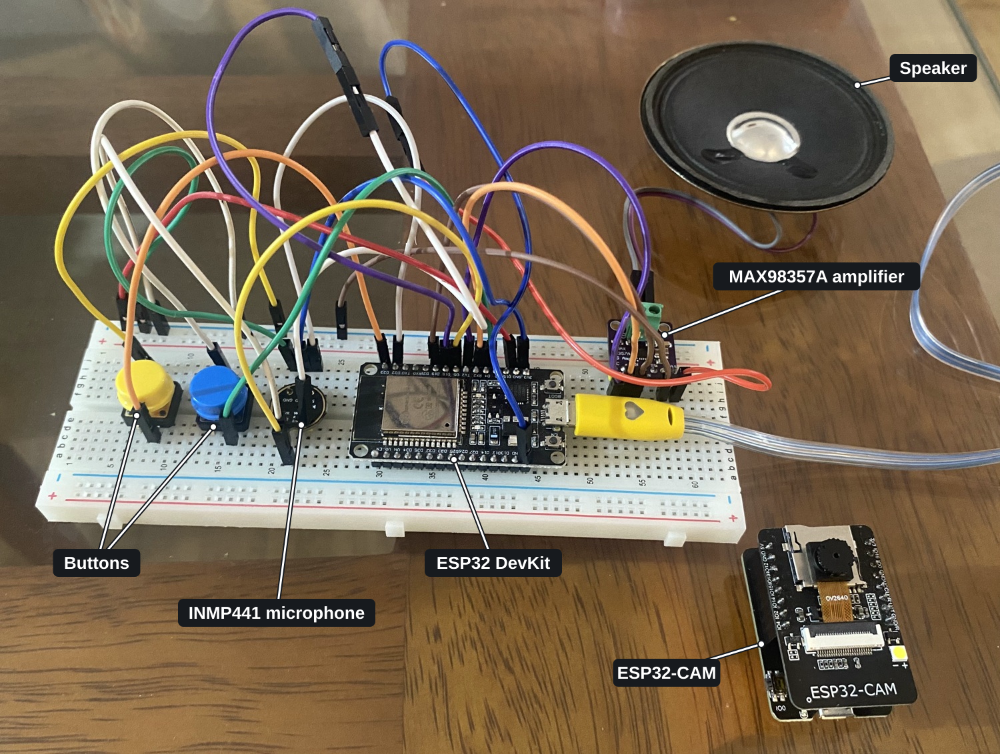
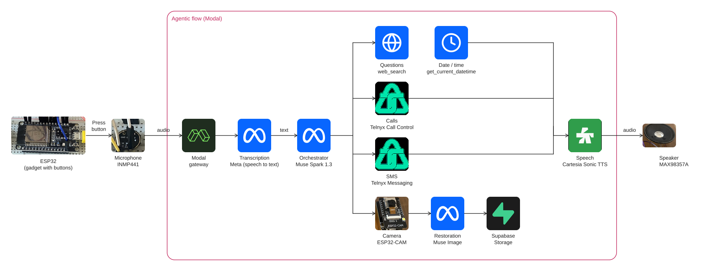

# Confio

Confio gives older adults access to AI through a push-to-talk device. In their own language, they can ask questions, look up information, call a family member, take and share photos, and stay in touch by SMS.

## 1. Impact · Closing the Digital Divide for Older Adults

Confio started with my aunt, who lives mostly on her own and finds smartphones difficult to use. When making a call or sharing a photo means navigating a screen she struggles with, the same interface can also put AI out of reach.

- **Global internet use.** In 2026, **76%** of the world's population, about **6.3 billion people**, uses the internet. The ITU identifies adults aged **75 and older** as the least connected age group. [ITU Facts and Figures 2026](https://www.itu.int/en/mediacentre/Pages/PR-2026-11-03-Facts-and-Figures.aspx) · [ITU Global Connectivity Report](https://www.itu.int/itu-d/reports/statistics/2025/11/17/gcr-2025-chapter-2/)
- **Peru.** In the second quarter of 2026, **56.7%** of adults aged **60 and older** used the internet, according to preliminary ENAHO data. Usage was **66.0%** in urban areas and **21.5%** in rural areas, a gap of **44.5 percentage points**. It was **60.1%** among older men and **53.6%** among older women. [INEI, ENAHO, Figure 36](https://www.inei.gob.pe/media/MenuRecursivo/boletines/informe_tecnico_adulto_mayor_2026_t2.pdf#page=22)
- **AI adoption by age.** In a 2025 U.S. survey, **10%** of adults aged **65 and older** reported ever using ChatGPT, compared with **58%** of adults aged **18–29**. [Pew Research Center](https://www.pewresearch.org/chart/majorities-of-adults-under-50-now-use-chatgpt/)

Confio uses Wi-Fi and replaces the smartphone interface with a physical button, a microphone, and a speaker. A person can ask a question or request an action aloud, then hear the result.

## 2. Use of Meta AI Tooling · Meta Models in Confio

| Meta model | How Confio uses it | What it enables |
| --- | --- | --- |
| Muse Voice Transcribe (`muse-voice-transcribe-1.0`) | Transcribes speech captured by the ESP32 microphone. | Users can ask questions and dictate messages aloud. |
| Muse Spark (`muse-spark-1.3`) | Follows the conversation and decides when to search the web or invoke tools for calls, SMS, and photos. | Users can ask for a photo, aim the camera, and tell Confio when they are ready on the next turn. |
| Muse Image (`muse-image-1.0`) | Restores the ESP32-CAM frame before sharing. | Users can share the restored photo and see the before-and-after result in the demo. |

## 3. Technical Depth & Execution · From Button Press to Action

| Component or tool | Role in Confio |
| --- | --- |
| ESP32 DevKit | Reads the push-to-talk button, streams microphone audio over Wi-Fi, and plays the audio returned by the agent. |
| INMP441 microphone | Captures the user's voice while they hold the push-to-talk button. |
| Modal gateway | Hosts the Python agent and accepts authenticated WebSocket connections from the voice device and camera. |
| Web search (`web_search`) | Looks up current information and provides sources the agent can cite in its answer. |
| Date and time (`get_current_datetime`) | Gives the agent the current date and time in the America/Lima time zone. |
| Telnyx | Connects phone calls and sends text messages or photo links to saved contacts. |
| ESP32-CAM | Takes a photo on request and sends the captured JPEG to the agent over Wi-Fi. |
| Supabase Storage | Stores the original and restored photos in a private bucket and provides expiring links for sharing. |
| Cartesia | Converts the agent's written reply into speech for playback on the device. |
| MAX98357A amplifier and speaker | Amplifies the ESP32's digital audio output and plays it aloud. |

## 4. Demo

## 5. Next Steps · From a Prototype to Everyday Independence

- **Portable hardware.** Shrink the circuit and put it in a 3D-printed enclosure so people can carry Confio around the house.
- **Home sensors.** Connect door and light sensors so users can ask whether a door opened or a light is off.
- **An agent-operated computer.** Give the agent a dedicated virtual machine to create a presentation, help with a spreadsheet, or teach Excel step by step. The agent could share the result through a link the user can open on a computer.
- **Banking by voice.** Explore Open Banking integrations for account queries, payments, and transfers, with authentication and explicit confirmation before moving money.
