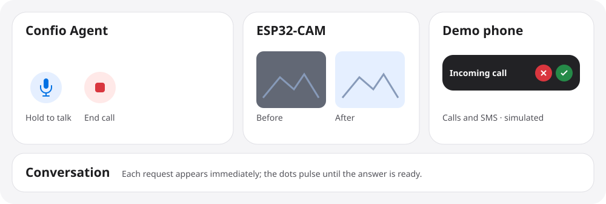
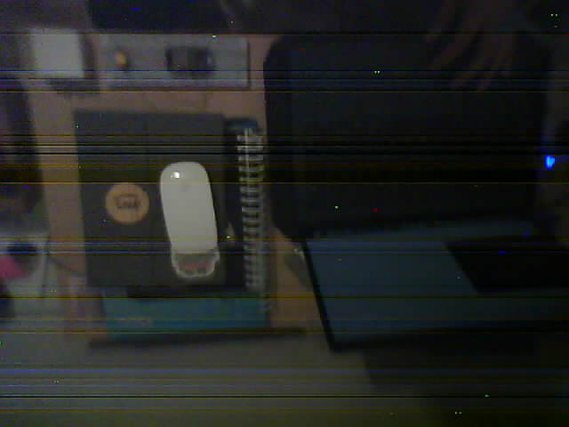

# Confio

Confio is a voice assistant for older adults who find smartphones difficult to
use. It started with my aunt, who lives mostly on her own. A large button lets
her ask a question, call a saved contact or share a photo by speaking.

Built for the Meta Global AI Developer Hackathon. The prototype connects a
handheld ESP32 voice device and a separate ESP32-CAM to an agent running on
Modal.

## Try the demo

The browser demo provides a **Confio Agent** card, an **ESP32-CAM** panel and a
**Demo phone**. It runs the same agent and photo tools with browser or sample
inputs. You can try it from this repository without an ESP32.



### Start locally

Use Python 3.12 or 3.13. Run from the repository root.

```sh
git clone https://github.com/JuanMontreuil08/confio.git
cd confio
python3 -m venv .venv-demo
source .venv-demo/bin/activate
python -m pip install -r deploy/requirements.txt
```

Set `META_API_KEY` and `CARTESIA_API_KEY` in your shell or in a local, ignored
`.env` at the repo root. Use a Meta key with access to Muse Spark, Muse Voice
Transcribe and Muse Image. Then start the demo.

```sh
python web/demo/server.py
```

Open [localhost:8080](http://localhost:8080). The keys stay on the server.
The demo uses a bundled ESP32-CAM sample by default. To configure a specific
Supabase photo, see [demo configuration](web/demo/README.md).

### What to press

| Try | What to do | What to look for |
| --- | --- | --- |
| **Talk to Confio** | Hold the microphone button, ask “What time is it in Lima?”, then release it. Allow microphone access when prompted. You can also type the request and press **Send**. | Your request appears in **Conversation**. The animated dots indicate that Confio is working. The transcript and spoken answer follow. |
| **Search the web** | Press **Search the web** or ask “What's the latest news in Lima?” | Muse Spark searches the web and names the sources it used in the response. |
| **Send a text SMS** | Say or type “Send Juan an SMS that says I arrived safely.” | The text appears in the simulated phone inbox. |
| **Answer, decline or end a call** | Press **Call Juan** or say “Call Juan.” On the phone, press the green button to answer or the red button to decline. If you answer, press **End call** on the agent card. | An incoming call banner displays Confio's caller ID. The phone shows whether the simulated call connected, was declined or ended. |
| **Restore a sample photo** | Press **Prepare a photo**, then **Take photo**. You can also say “I want to take a photo,” wait for Confio to ask you to aim, then say “I'm ready. Take the photo.” | **Before** shows the original ESP32-CAM sample. **After** appears once Muse Image restores it. |
| **Restore a webcam photo** | In **ESP32-CAM**, press **Use webcam**, allow access, frame the image and press **Capture photo**. | The captured frame becomes **Before**. Muse Image produces **After**. |
| **Share the photo** | After restoring a photo, press **Share photo** or say “Send the photo to Juan with the message: Take a look at this.” To skip a caption, say “Send only the photo to Juan.” | The simulated phone shows the restored photo and any dictated text. If you ask to share a photo without specifying whether to include text, Confio asks once before sending. |

<details>
<summary>See an original camera sample included in the repository</summary>



</details>

### Live and simulated behavior

- **Live** — Meta speech transcription, Muse Spark reasoning and web search,
  Muse Image restoration, and Cartesia speech playback.
- **Simulated** — the ESP32 button and camera input, phone connection and SMS
  delivery. Demo calls and messages stay in the demo. Photo saves are local to
  the demo session.
- **Physical prototype** — the ESP32 streams audio and the ESP32-CAM sends
  captured frames. The deployed agent stores photos in private Supabase Storage
  and uses Telnyx for real calls and SMS to saved contacts.

## Stack

| Layer | Technology |
| --- | --- |
| Device | ESP32 DevKit, INMP441 I2S microphone, MAX98357A I2S amplifier, speaker and two buttons |
| Camera | ESP32-CAM with OV2640 |
| Firmware | Arduino C++ and PlatformIO, with authenticated WebSockets over WiFi |
| Agent | Python and aiohttp, hosted on Modal with GitHub Actions CI/CD |
| Meta models | Muse Voice Transcribe for speech input, Muse Spark for reasoning and tools, Muse Image for restoration |
| Integrations | Cartesia for speech output, Supabase Storage for private photos, Telnyx for calls and SMS |
| Judge demo | HTML, CSS, JavaScript and the existing Python agent |

## Source and hardware

- [Browser demo setup](web/demo/README.md)
- [Agent prompt](prompts/assistant_system.md) and [photo and SMS tools](scripts/photo_tools.py)
- [Firmware and Modal deployment](deploy/README.md)
- [ESP32 voice wiring and local testing](esp32/voice/README.md)
- [ESP32-CAM firmware](esp32/camera/README.md)

The original contributions for this hackathon are the push-to-talk voice device,
the camera and photo-sharing workflow, the tool-driven agent and its WiFi
deployment, and the hardware-free browser demo.
